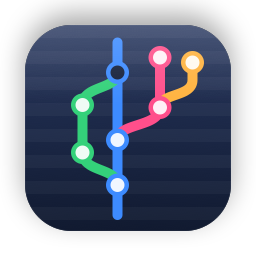
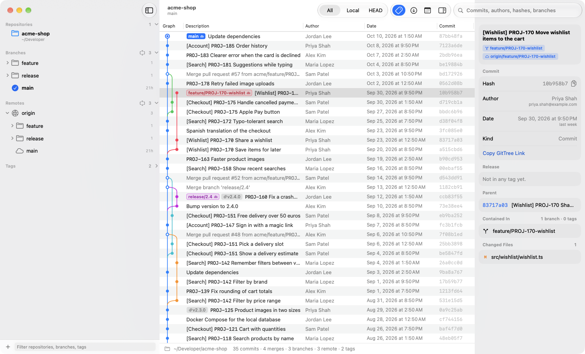

[](LICENSE)<br>[](https://github.com/fredy-mederos/vibe_gittree/releases/latest)

<br clear="left"/>

# Vibe GitTree

**Vibe GitTree** is a fast, read-only explorer for git history: a native macOS app (SwiftUI + AppKit) for
browsing any number of repositories, local or remote.

<p align="center">
  
</p>

Ideas queued for later are in [TODO.md](TODO.md). It's a personal project under the
[MIT license](LICENSE): clone it and fork it freely, and open an issue for bugs or ideas; pull
requests aren't accepted (see [CONTRIBUTING.md](CONTRIBUTING.md)).

## Vibe GitTree for macOS

### Download

**[Download VibeGitTree.dmg](https://github.com/fredy-mederos/vibe_gittree/releases/latest/download/VibeGitTree.dmg)**
(the latest release, for macOS 15 or later on Apple silicon and Intel), open it and drag Vibe GitTree into
Applications. Every version is on the [releases page](https://github.com/fredy-mederos/vibe_gittree/releases).

Vibe GitTree tells you when there's a new version: it asks GitHub when it opens and once a day, and
shows an alert once per new version. Vibe GitTree › Check for Updates… and Settings › General check
any time.
The disk image doesn't include the `gittree` command; copy [`scripts/gittree`](scripts/gittree) into
a folder on your `PATH`, or build Vibe GitTree yourself as below.

Vibe GitTree was called GitTree until version 1.2.0. If you had GitTree, move it to the Trash after
installing Vibe GitTree: your repositories and settings carry over, and the `gittree` command and
`gittree://` links work as before.

### Build and install from source

Requires macOS 15 or later and Xcode (built with Xcode 27).

```bash
scripts/install.sh
```

This builds an optimized copy and installs it into `~/Applications`, where Launchpad and Spotlight
find it, and installs the `gittree` command into `~/.local/bin`. Pass another folder to install the
app elsewhere, for example `scripts/install.sh /Applications`. To work on the app, open
`GitTree.xcodeproj` and press Run.

The first time Vibe GitTree reads a repository inside Documents, Desktop or Downloads, macOS asks for
permission to access that folder.

### What it does

- **Library of repositories** in the sidebar, each with its location underneath
  (`~/Documents/projects/acme`, or `github.com/owner` for cloned ones). Add folders from your Mac
  (File › Add Local Repository, ⌘O, or drag them in), every repository inside a folder (File › Add
  Repositories in Folder…, which looks four levels deep and skips `node_modules`, build folders and
  the like), or clone remote ones by URL (File › Clone Remote Repository, ⇧⌘O). The list shows the
  first eight with "Show All"; the filter at the bottom matches repositories too; the + menu sorts
  them by your own order (drag), name, or recently opened, and can group them by folder or host.
  Right-click › Pin to Top keeps favorites above the rest.
- **Switch quickly** with ⌘K: type part of a name or path, press Return. Without typing, it lists
  repositories most recently opened first. Right-click a repository for Open in New Tab or Open in
  New Window to see several at once.
- **Remote repositories** are cloned into Vibe GitTree's own storage as bare, blobless clones: commits
  and folder structure only, no file contents. They fetch automatically when opened (if the last
  fetch was over 10 minutes ago) and on Fetch (⇧⌘F).
- **Commit graph** of every branch, remote branch and tag, newest first, with colored lanes, branch
  and tag labels (a cloud marks a local branch in sync with its remote), and the checked-out commit
  ringed. Narrow it to local branches (⌘2), the current branch (⌘3) or a single branch (right-click
  › Show Only).
- **Live updates**: local repositories reload by themselves when you commit, check out or fetch in
  the terminal, keeping your scroll position and selection.
- **Search** (⌘F) across subjects, authors, hashes and branch names; Return or ⌘G for the next match,
  ⇧⌘G for the previous one.
- **Commit details** (the inspector on the right): full message, author and committer, links to the
  commit and its pull request on GitHub, GitLab or Bitbucket, ticket links, the first release tag
  that contains the commit, parents and children, the branches that contain it, and changed files.
  It keeps the width you drag it to, in every window and repository and from one launch to the next.
- **Branches, remotes and tags** in the sidebar, grouped by folder (`feature/`, `release/`…) and by
  version for tags, newest first with their age. Click one to jump to it; double-click (or Return)
  to show only its history.
- **Changes**: click a file in the inspector to open its diff in its own window, with syntax colors
  (Swift, Kotlin, Java, JavaScript/TypeScript, Python, Go, Rust, C/Objective-C, Ruby, shell, JSON,
  YAML, XML/HTML, Markdown and more), a Side by Side toggle that puts the old and new file next to
  each other, a Whole File toggle, a link to the file on GitHub, and Copy Link.
- **Pull requests** (GitHub, through the `gh` command): an open pull request's number next to its
  branch in the graph and sidebar, with its checks (✓ passed, ✗ failed, clock running). Stacked pull
  requests (based on another open PR's branch) show their position, like `#8161 · 5/5`. The sidebar
  lists every stack in order, plus open, draft, recently merged and recently closed pull requests.
  Select an open pull request to highlight its commits in the graph (those on its branch that
  aren't on the branch it's based on), or the whole stack's when it's stacked; right-click a stack ›
  Highlight Stack does the same. The inspector shows the pull request that merged a commit, its
  review and checks, and the whole stack.
- **Pull request timeline**: the selected pull request's story under it in the sidebar, and in the
  inspector with Show Timeline: a line from opening to merge (or to now) with a mark per event,
  then the events (opened, with how many commits; commits added later, grouped when they're close
  together; review requests, approvals, changes requested and comments; force pushes, draft
  changes, merged or closed, with who and when), and how long it took: "Merged after 21 hours,
  approved after 20 hours". GitHub doesn't say when commits were pushed, so their commit times
  stand in; bots' review comments are left out.
- **Jira** (Settings › Jira): profiles, each a Jira Cloud site and the account to use there. Every
  repository picks its profile or none, in Settings › Jira or in its Repository Settings, and new
  repositories start with the default profile. Repositories with a profile get a Ticket column with
  each commit's ticket status and fix version, bugs marked with a ladybug (its tooltip names the
  type and the epic), and a Ticket section in the inspector with summary, type, assignee, fix
  version, the story or task a sub-task belongs to, and the epic (click it to highlight the whole
  epic).
- **Definition of Done** (Settings › Jira): per Jira project, the statuses that count as done on
  the development side, like "Dev Done" or "Ready for Release", typed or picked from the statuses
  seen in that project's tickets. They count as done like Jira's Done and Released: in the
  progress of releases and epics (green), in the status colors and in Highlight.
- **Epics** (with Jira connected): the sidebar's Epics section lists the tickets in the latest
  commits (500 by default, 200 to 2,000 in its menu) under their Jira epics, most recently worked on
  first, with each epic's key, status, tickets and commits, and a bar of how many of all its stories
  and tasks are done, in progress or to do; tickets without an epic come last. Epics that are
  already live (Done, Released or another status in Jira's done category; a Definition of Done
  doesn't count) are left out with their tickets, and a note says how many. A sub-task's epic is the
  one above its story or task, as in projects where commits mention sub-tasks. Select an epic to
  highlight its commits: right away those of the tickets listed, then, once Jira answers, every
  commit in the history that mentions any ticket in the epic (one `parentEpic` query, which takes in
  its stories, tasks and sub-tasks). The epic opens to list its tickets; select one to highlight its
  commits and its sub-tasks'. The ↻ button in the section's header asks Jira again about the recent
  tickets, after you've changed them there.
- **Releases** (with Jira connected): the unreleased fix versions of the repository's Jira projects
  (taken from its ticket keys), soonest release date first, with the date (orange when overdue) and
  a bar of how many of their tickets are done, in progress or to do (with a Definition of Done,
  counted from the tickets themselves). Versions this repository's
  tickets are in come first; the others (another platform's, say) are under Other Fix Versions.
  Select one to highlight the commits of its tickets and their sub-tasks; it opens to list its
  tickets with their status and commits here, dimming those no commit mentions. After changing
  tickets or releases in Jira, the ↻ button in the section's header asks Jira again for the fix
  versions (dates and progress) and the tickets of the open ones; an open fix version has a ↻ of
  its own (and Refresh in its context menu). Tickets that left a fix version are read again too,
  so the fix version next to their commits is current.
- **Highlight** (toolbar, with Jira connected): tint the commits of tickets that aren't done, are in
  progress or to do (among the latest 500 commits), or of every ticket in a fix version (asked of
  Jira directly, so it covers tickets beyond what's on screen). The status bar steps through them.
- **Compare branches** (Repository › Compare Branches…, ⇧⌘B, or right-click a branch or tag ›
  Compare with…): two branches or tags side by side in their own window. It says how many commits
  each has that the other doesn't and where they diverged, then lists, for each side, its commits,
  its tickets (under their epics, with their status, marked when the other side has commits for
  them too), the files changed since the branches diverged, and its authors. Click a commit to
  select it in the graph; Highlight in Graph tints one side's commits there.
- **Features** (off unless Settings › General › Group recent commits into features turns it on):
  the sidebar's Features section groups the latest commits (100 to 1,000) under the
  terms your team writes in commit messages: bracket tags like `[Search]` or `[Tech Debt]` and scope
  prefixes like `github-pr:`. A ticket takes its commits' most common term, so untagged commits of a
  tagged ticket follow it. Terms and assignments are remembered per repository; only work without a
  term goes to Apple's on-device model, which picks an existing term or suggests a new one (commit
  messages never leave the Mac). Each ticket is a feature named after its most descriptive commit.
  Select one to highlight its commits in the graph. With Jira connected, the Epics section above it
  groups the same work by the epics in Jira instead, which needs no guessing.
- **Activity** (toolbar calendar button or ⇧⌘A): a contribution grid with one square per day, shaded
  by commits, for the last 12 months or any year, filtered by branches and author. Hover a day to
  see its tickets (with their terms, when Features is on) and commits; click to keep it; click a commit to select it in
  the graph.
- **Deep links**: `gittree://open?repo=<path|remote URL|name>&commit=<sha>&path=<file>&line=<n>`
  opens the repository (adding it if needed), selects the commit and opens the file's diff scrolled
  to the line. The `gittree` command builds these links: `gittree <file>:<line>` finds the commit
  that last changed that line with `git blame`; `gittree <file>`, `gittree <commit>` and plain
  `gittree` work too; `--print` prints the link without opening the app.
- **Per-repository settings** (right-click › Repository Settings): display name, the Jira profile,
  the ticket keys to look for (`PROJ`, or several separated by commas; empty detects them from commit
  messages), an issue link such as `https://example.atlassian.net/browse/{key}` for ticket keys when
  tickets live somewhere else, and the regular expression that marks release tags (for example
  `^android-v[\d.]+$` when releases are tagged `android-v2.12`).
- **Appearance**: Settings › General › Appearance picks Light, Dark or System. Dark mode is a bit
  darker than macOS's: the window, the commit list, the sidebar and the details.
- **About**: Settings › General shows the version, the build number (the commit count when
  `scripts/install.sh` or `scripts/release.sh` built it), the commit, whether it's a Debug or
  Release build, and when it was built, with Copy Version Info.
- **Updates**: Vibe GitTree asks GitHub for the newest release a few seconds after it opens and once a
  day while it's open. A new version gets an alert, once, with Download (the disk image) and Release
  Notes; Settings › General keeps showing it until you update. Vibe GitTree › Check for Updates… and
  Settings › General › Check Now ask any time.

Vibe GitTree never changes your repositories. The only git command that writes anything is `fetch`,
and only when you ask for it (or when a remote repository Vibe GitTree cloned itself is opened).

### How Vibe GitTree talks to GitHub and Jira

Both integrations are deliberately gentle, so scrolling or reloading can never turn into a storm of
requests (and so is the update check):

- **Updates**: one request to GitHub's API for the latest release of this repository, a few seconds
  after Vibe GitTree opens (at most once an hour) and once a day while it's open, plus whenever you ask.
  It has a 20-second timeout and sends nothing about you or your repositories. GitHub allows 60 such
  requests an hour per network; when they're used up, Vibe GitTree reads the website's "latest release"
  link instead. Nothing is downloaded until you choose Download.
- **GitHub**: two `gh pr list` calls per refresh (pull requests, then reviews and checks of the
  open ones), only for repositories a window shows (or when you press Fetch). One refresh runs at a
  time across all repositories, at most every five minutes per repository (30 seconds after
  Fetch), and only when something prompts it: opening the repository, its history changing, Fetch.
  A refresh asks for the 100 pull requests updated most recently and merges them into what's
  known (three API requests in all); the full list of the latest 400 (five) comes at most every
  six hours, or on Fetch. Each call has a 30-second timeout; after a failure it waits 5 minutes,
  then longer. A pull request's timeline is one `gh api graphql` call when you select it (after a
  short pause, so arrowing through the list doesn't ask for every row), in the same one-at-a-time
  line; it's kept for five minutes while the pull request is open and for good once it's merged or
  closed, and after a failure that pull request waits a minute.
- **Jira**: one request at a time across all profiles and everything below, at most 20 a minute.
  Every ticket comes in one request with everything Vibe GitTree shows about it: status, type,
  assignee, fix versions and its parent (the epic, or for a sub-task its story or task). Tickets
  are asked for in bulk, up to 50 per request: the ones on screen once scrolling pauses, along with
  those a screen above and below, so scrolling on doesn't send a request per screen. Answers are
  cached on disk per profile (`jira-cache.json`) and asked for again only when they're on screen
  and older than an hour (a day for done tickets). Unknown tickets aren't asked about again for a
  day. The Epics section asks only about recent tickets Jira hasn't answered about yet (three
  requests the first time a 500-commit stretch of a busy repository opens, then only new tickets),
  plus once the stories and tasks above sub-tasks, since a sub-task's parent doesn't name the epic;
  tickets on screen go ahead of those. A repository's unreleased fix versions are one request per
  project at most every hour, and only for projects Jira has returned tickets for. For their
  progress, the stories and tasks of the epics listed are one query (a request per 100 tickets) at
  most every hour, and so are the tickets of the fix versions of projects with a Definition of Done
  (Jira counts a fix version's tickets only by status category). A fix version's or an epic's
  tickets take at most five requests, only when you select or open one, and are reused for ten
  minutes. A rejected token stops that profile's requests until its settings change;
  timeouts back off, and Jira's requests to slow down are honored (up to ten minutes). Editing a
  profile drops anything still queued or in flight with the old credentials. Sites without bulk
  fetch get JQL search, with smaller batches after a query fails on an unknown key, paced like
  everything else; sites without `parentEpic` get an epic's tickets level by level. Asking again
  is up to you, never automatic: Repository › Refresh Ticket Statuses asks again for what's on
  screen; the Epics section's ↻ for the recent tickets, fix versions and the epics' stories and
  tasks; the Releases section's ↻ for the fix versions (one request per project), all the tickets
  of those with a Definition of Done (one query) and those of the other open ones (one request
  each), plus one for any tickets that left them, the rest waiting until they're next opened; an
  open fix version's own ↻ for its project's fix versions and its tickets.

### Shortcuts

| Action | Keys |
| --- | --- |
| Switch to repository | ⌘K |
| Add local repository | ⌘O |
| Clone remote repository | ⇧⌘O |
| Find commits / next / previous | ⌘F / ⌘G / ⇧⌘G |
| All branches / local / current | ⌘1 / ⌘2 / ⌘3 |
| Go to HEAD | ⇧⌘H |
| Show activity calendar | ⇧⌘A |
| Compare branches | ⇧⌘B |
| Fetch / reload | ⇧⌘F / ⌘R |
| Commit details for the selected row | Return or double-click |
| Repository settings | ⌥⌘, |

### Where things are stored

`~/Library/Application Support/GitTree/` (the app's former name, so nothing had to move): `library.json` (the repository list and per-repository
settings), `jira-profiles.json` (Jira sites and accounts, without tokens), `jira-cache.json` (ticket
statuses, with their parents, and unreleased fix versions per profile) and
`Clones/<host>/<owner>/<name>.git` (remote repositories). Jira API tokens
are in the login keychain. Removing a remote repository from
Vibe GitTree deletes its clone; removing a local one never touches the folder.

### How it's built

```
GitTree/
  App/           app entry point, menu commands, version info and update checks
  Git/           running git, parsing history, lane layout, diffs, clone, file watching, hosting links
  Integrations/  GitHub (gh, pull request timelines), Jira (REST + keychain), feature grouping (Foundation Models)
  Model/         repository library, per-repository model, per-window state, sidebar tree, deep links,
                 epics and releases, branch comparison
  Views/         window, sidebar, switcher, toolbar and status bar, inspector, diff and compare windows, sheets
  Views/Graph    the commit table (NSTableView) and its Core Graphics cells
Support/Info.plist   the gittree:// URL scheme (merged with Xcode's generated keys)
scripts/gittree      the deep-link command
```

- History comes from one `git log --branches --remotes --tags --date-order` plus `git for-each-ref`,
  parsed byte by byte into parallel arrays. On a 15,858-commit Android repository, loading,
  parsing and laying out the graph takes about half a second in a debug build.
- The lane layout is one top-to-bottom pass: a commit takes
  the longest-lived lane waiting for it, so mainlines like `develop` keep their column and color.
- The table is an `NSTableView`, which only creates views for visible rows, so very large histories
  scroll as smoothly as small ones. Graph cells draw their segments with Core Graphics.
- Layouts, search and "contained in" walks run off the main thread.

### Checking the UI from the command line

Debug builds accept launch arguments, and `scripts/snapshot.sh` launches the app with a throwaway
library and captures only its window:

```bash
scripts/snapshot.sh /tmp/gittree.png 6 -GTOpenRepository ~/code/some-repo -GTSearch "fix"
```

Arguments: `-GTOpenRepository <path>`, `-GTCloneURL <url>`, `-GTAddFolder <path>`, `-GTSearch <text>`,
`-GTScope local|head|refs/heads/<branch>`, `-GTAppearance dark|light` (whatever the Appearance
setting says), `-GTShowSwitcher YES`, `-GTGroupFeatures YES` (shows the Features section and groups),
`-GTSelect epic:<key>|release:<name>|ticket:<key>|pr:<number>|ref:<name>` (selects that sidebar row
once it's there; `first` for the first epic or release, `open` for the newest open pull request;
several, separated by commas, are selected one after another), `-GTRefresh releases|release|epics`
(refreshes the Releases or Epics section, or the selected fix version, after `-GTRefreshAfter`
seconds, 10 by default), `-GTCompare <base>...<head>` (opens the comparison), `-GTJiraSite <url>`
(with optional `-GTJiraEmail`/`-GTJiraToken`) to use a Jira site without touching the keychain,
`-GTCheckForUpdates YES` (checks for updates at launch, as the installed app does; debug builds
otherwise only check when asked) and `-GTUpdateRepository <owner/name>` (checks another repository's
releases, without keeping what it finds; one with a newer version shows the update alert). Test
runs keep the sidebar's folded sections, the details' width and the Features setting in a
preferences suite of their own, emptied at launch.

`scripts/snapshot-rows.sh` captures the window once per row `-GTSelect` names, for checking how
selected rows look (in light and dark mode, say):

```bash
scripts/snapshot-rows.sh /tmp/rows -GTOpenRepository ~/code/some-repo -GTAppearance dark -GTSelect "ref:main,pr:open"
```

Some checks don't need a screenshot (or Vibe GitTree in front): `-GTDescribeJira <file>` writes, after
`-GTDescribeAfter` seconds (20 by default), what the Epics and Releases sections list, the
highlight, the sidebar selection and a selected pull request's timeline; `-GTDescribeCompare <file>`
writes what a comparison found.

To try the Jira integration without real credentials, run the mock server and point a debug build
at it; it logs every request, which makes it easy to check that scrolling doesn't flood Jira. Its
tickets have epics, stories, tasks and sub-tasks, and every project it has answered tickets for
has six unreleased fix versions (`--no-parent-epic` rejects `parentEpic` queries, `--projects=A,B`
names the projects instead):

```bash
python3 scripts/mock-jira.py 8899
scripts/snapshot.sh /tmp/gittree.png 8 -GTOpenRepository ~/code/some-repo -GTJiraSite http://127.0.0.1:8899
```

### Releasing

`scripts/release.sh` builds a Release for Apple silicon and Intel, signs it with a Developer ID (with
the hardened runtime), packs it into `build/VibeGitTree.dmg`, has Apple notarize it and staples the ticket:

```bash
APP_SIGN_IDENTITY="Developer ID Application: Your Name (TEAMID)" \
  NOTARY_KEYCHAIN_PROFILE=<profile> scripts/release.sh
```

The `release-vibe-gittree` skill (`skills/`, linked for Claude Code and Codex) runs a whole release: it
picks and confirms the version (`scripts/version.sh`), builds the disk image, tags `vX.Y.Z` and
publishes the GitHub release with notes from `scripts/release-notes.sh`. Installed copies find it
within a day.

## License

MIT, see [LICENSE](LICENSE).
